# Two-Stage-Miller-Compensated-Operational-Amplifier
All the derivations can be found in textbook by P. Allen and D. Holberg,"CMOS Analog Circuit Design", The Oxford Series in Electrical and Computer Engineering.

## DESIGN SPECIFICATION OF OPAMP
Gain= 60db 
Slew rate = 20 V/uS 
GBW (Gain Bandwidth) = 30 MHz 
Phase Margin = >=60 degree 
ICMR(+)= 1.6 V 
ICMR(-)= 800 mV 
Vdd = 1.8 V 
Cl (Load Capacitance) = 2pF 

## CIRCUIT DIAGRAM
The circuit of opamp which includes all the differntial pair and current mirror made using the nmos2v and pmos2v from the 90nm (gpdk90) library.

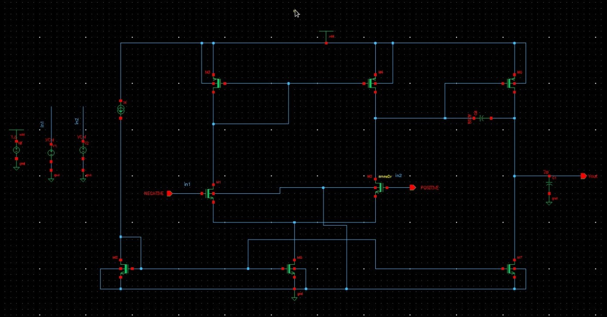
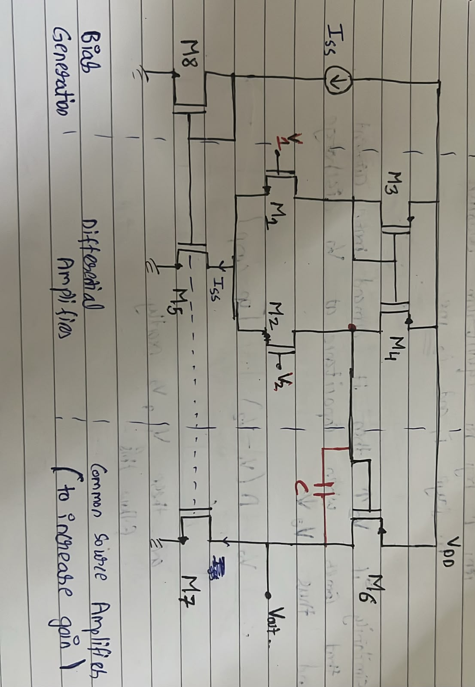

## DESIGN 
### Design of input transistor M1 and M2 
For a safer design initial Length = 500nm ( L>= 2*Lmin)

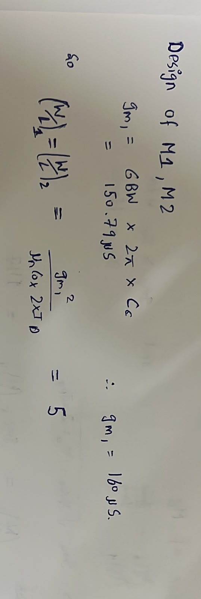

### Finding Minimum and maximum Threshold value
After designing M1 and M2 the circuit arrangement is used to find the threshold limits for all of these transistors. Note until now M3 and M4 are not designed so assume a suitable W/L ratio and take a margin of safety in threshold value obtained.

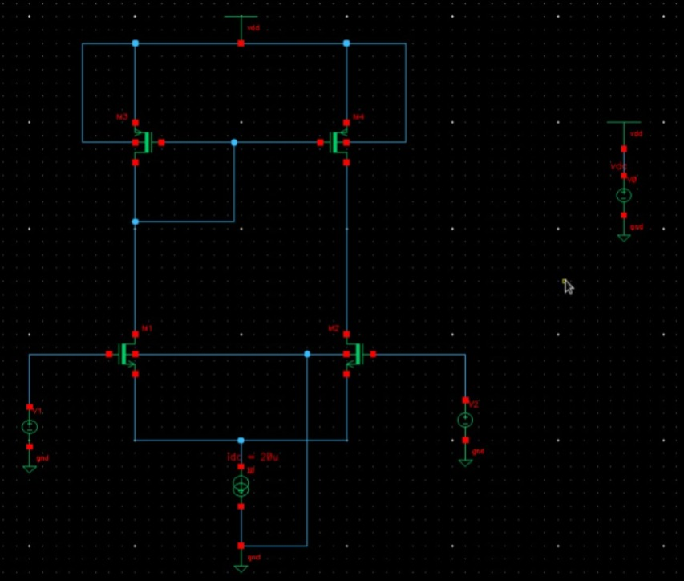

### Design of mirror load (M3 and M4) and tail current source transistor (M5 and M8)

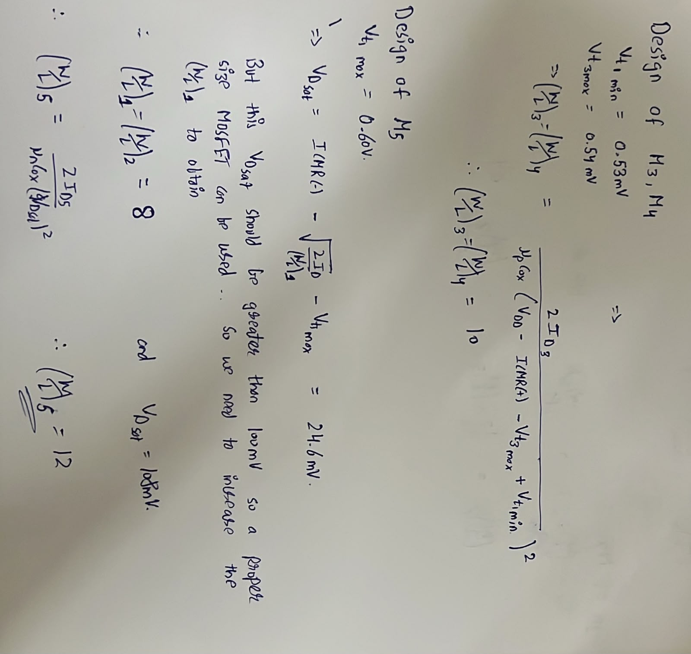

### Design of second stage input transistor M6 

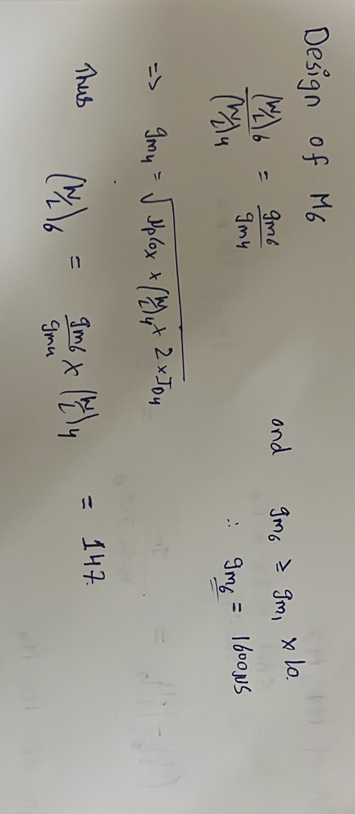

### Design of current source transistor for second stage M7

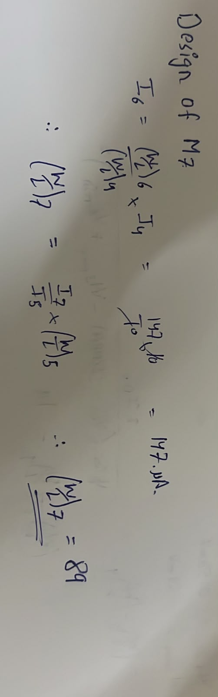

### Deciding values of compensation capacitor (Cc) and bias current (I)
We have target Slew rate and given Load capacitor CL in the specification. We also have the target of Phase margin > 60 degree. The condition for 60 degree phase margin is Cc>=0.22xCL Hence, for our project Cc should be more than or equal to 2.2pF. So initially choosing Cc = 800fF. Now, Slew Rate = I5 / Cc so I5 (I) = SR x Cc = 20μA.

The DC Analysis for boundary values 1.6V and 0.8V is:

  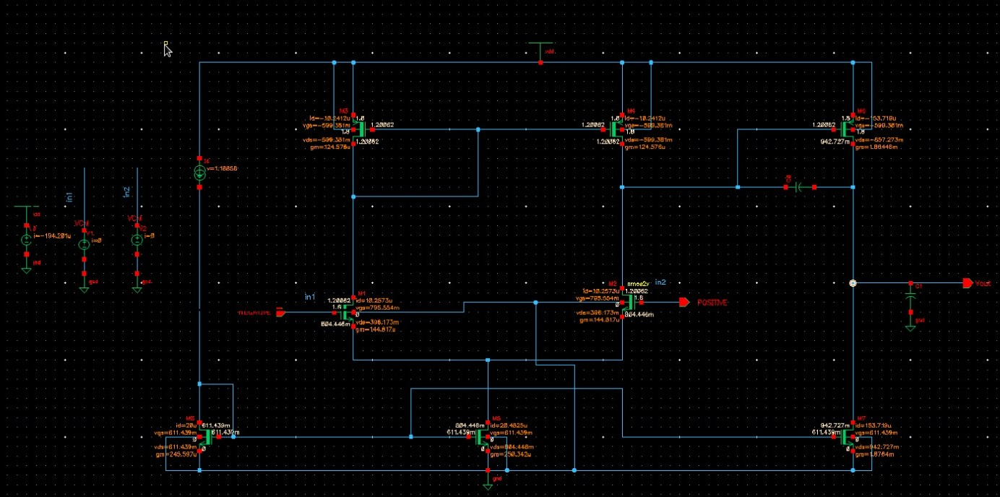
  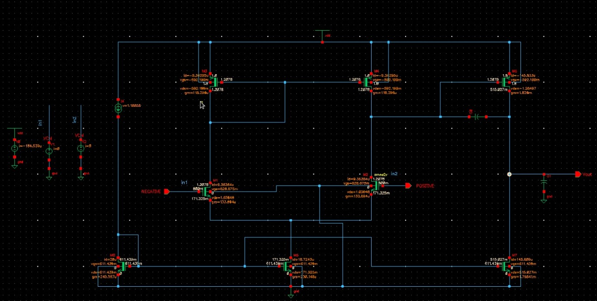

## Re-Design
After the initial design and DC analysis the obtained DC operating points are used to calculate the gain.

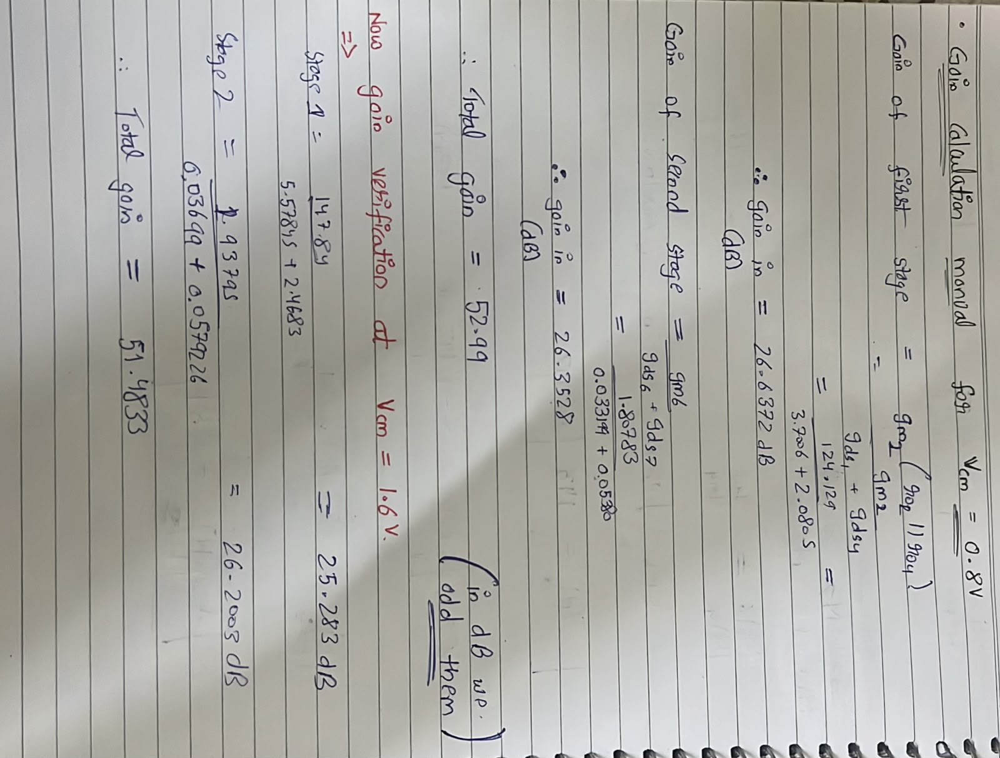

In both cases the obtained gain is lesser then the desired target. So will increase the "Length" keeping same W/L ratios to obtain a higher gain and simultaneously will adjust Cc value to get phase margin closer to 60 degree. The length is increased from 500um to 1000um and Cc = 850fF to meet the specifications. For precise tunning we can further change length and Cc accordingly but this is a rough estimation with no length related constraints. All this is monitored and measured using the AC analysis by plotting gain and phase margin plot.

The final Gain and Phase margin plots for different common mode voltages are:

  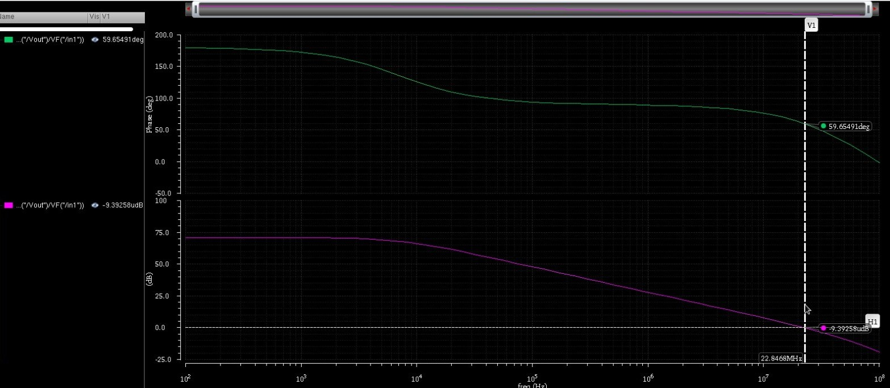
  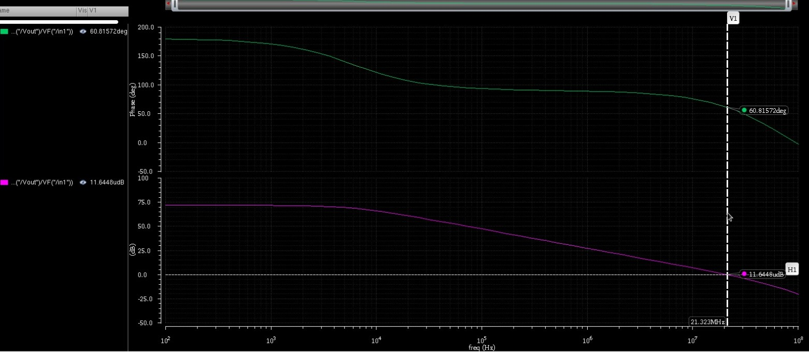

The GBW for 1.6V is : 22.8468 MHz
The GBW for 0.8V is : 21.3223 MHz

Furthermore we can also calculate further design parameters.

## COMMON MODE REJECTION RATIO (CMRR)

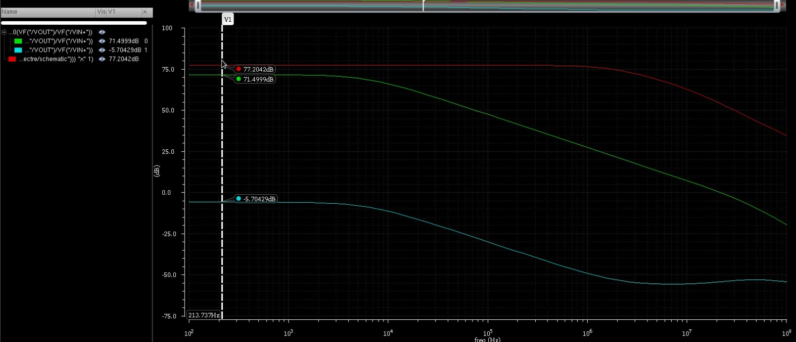

The Blue curve here represents, CMRR = Adm - Acm (71.4999 -(-5.7042)) = 77.2042dB

## SLEW RATE 

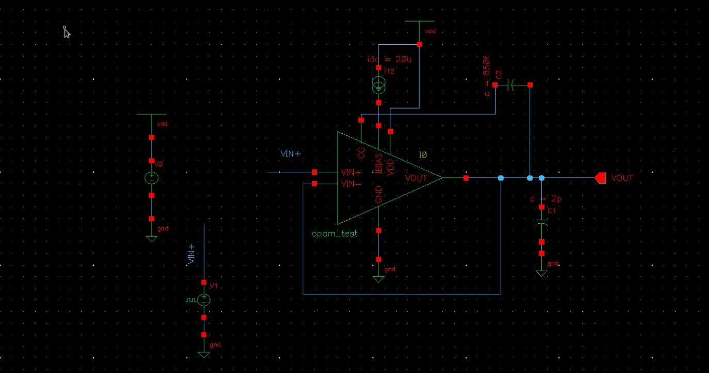

  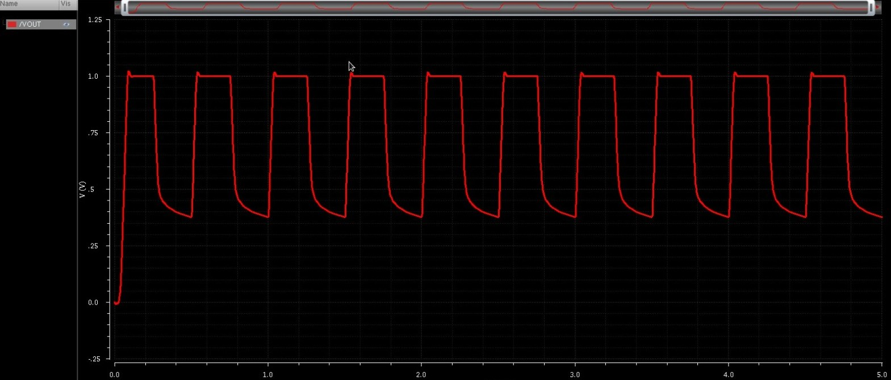
  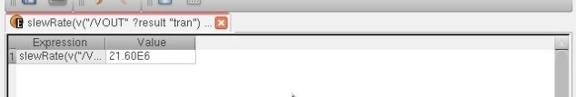

The Slew Rate obtained is 21.60 V/us which is close to the design target.

## POWER DISSIPATION

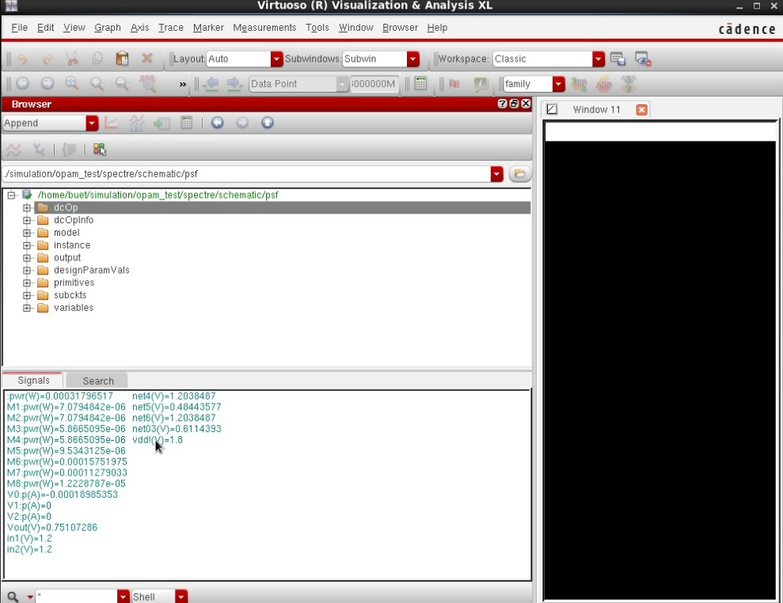

Net power dissipated is 317uW

